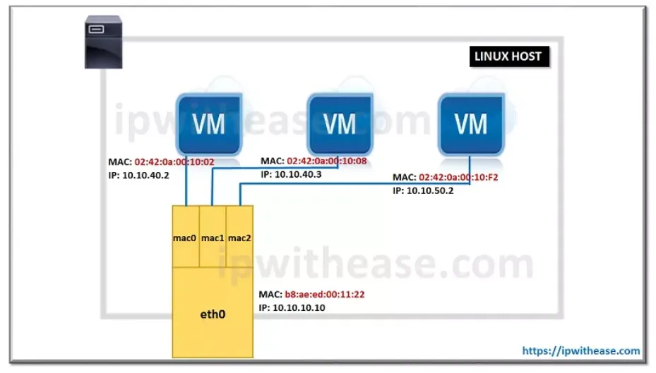
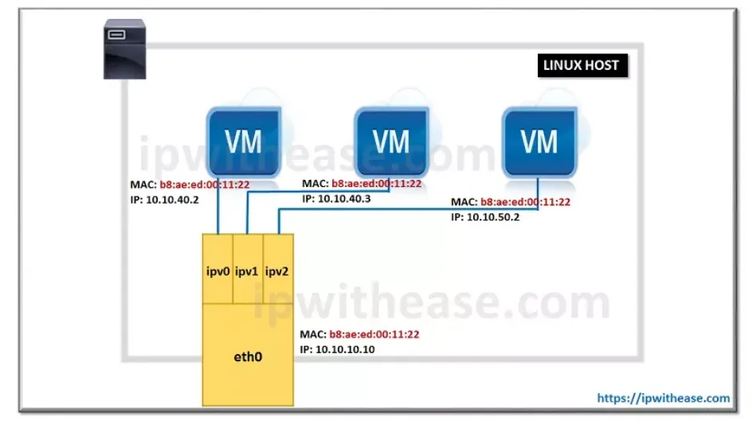

# Docker — Networking

How containers talk to each other, to the host and to the network.

Back to: [docker-cheatsheet.md](./docker-cheatsheet.md) · Official docs: <https://docs.docker.com/engine/network/>

---

## Network drivers

| Driver | Container IP | Isolated from host | Use case |
|---|---|---|---|
| **Default bridge** | Private (172.17.0.0/16) | Yes | Quick tests |
| **Custom bridge** | Private, your subnet | Yes | Most applications |
| **Host** | Same as host | No | Performance, many ports |
| **Macvlan** | On your LAN, own MAC | Yes | Container must look like a real device |
| **IPvlan L2** | On your LAN, host MAC | Yes | Like macvlan, but the switch limits MAC addresses |
| **IPvlan L3** | Routed subnet | Yes | Many containers, routing instead of broadcast |
| **Overlay** | Private, across hosts | Yes | Docker Swarm (multi-host) |
| **None** | No network | Yes | Full isolation |

```bash
docker network ls          # List networks
docker network inspect <name>
docker network rm <name>
docker network prune       # Delete unused networks
```

---

## Default bridge

Used when you don't choose a network. Containers on the same host can talk with their **IP only** (no DNS by name). Use a custom bridge instead.

```bash
docker run -d --name web nginx       # Connected to "bridge"
```

---

## Custom bridge

Recommended in most cases.

- Automatic DNS: containers reach each other **by name**
- Better isolation: only containers on this network can talk together
- You can connect and disconnect containers while they run

```bash
docker network create my-net                 # bridge is the default driver
docker network create -d bridge --subnet 172.30.0.0/24 my-net   # With a chosen subnet

docker run -d --rm --network my-net -p 8080:80 --name web nginx
docker run --rm --network my-net alpine ping -c 2 web   # Works with the name

docker network connect my-net other-container
docker network disconnect my-net other-container
```

Flags: `-d` background · `--rm` delete when stopped · `-p host:container` publish a port.

---

## Host

No network isolation: the container uses the network of the host directly.

```bash
docker run -d --rm --network host --name web nginx   # nginx listens on host port 80
```

- `-p` is ignored (the ports are already on the host)
- Good performance, no NAT
- Full support on Linux only

---

## Macvlan

Each container gets **its own MAC address** and an IP on your physical network. It looks like a separate device on the LAN.


*Each container has its own MAC address. Diagram: [ipwithease.com](https://ipwithease.com)*

```bash
docker network create -d macvlan \
  --subnet 192.168.1.0/24 \
  --gateway 192.168.1.1 \
  --ip-range 192.168.1.192/27 \
  -o parent=enp0s3 \
  my-macvlan

docker run -d --rm --network my-macvlan --ip 192.168.1.200 --name web nginx
```

- `parent` = the physical interface of the host (`ip a` to find it)
- `--ip-range` = the part of the subnet Docker can use. Choose a range **outside your DHCP range** to avoid IP conflicts.
- `--ip` = fixed IP for one container (optional)

### Macvlan with VLAN (802.1Q trunk)

If the parent name has a dot, Docker creates the VLAN sub-interface for you. Here `enp0s3.20` = VLAN 20 on `enp0s3`.

```bash
docker network create -d macvlan \
  --subnet 192.168.20.0/24 \
  --gateway 192.168.20.1 \
  -o parent=enp0s3.20 \
  my-macvlan-vlan20
```

The switch port must be configured as a trunk with this VLAN.

### Macvlan pitfalls

- **The host cannot reach its own macvlan containers** (and the reverse). Other devices on the LAN can. To fix it, create a macvlan interface on the host.
- The interface must accept many MAC addresses. In a VM (VirtualBox, Proxmox...), enable **promiscuous mode** on the network card.
- Some switches limit the number of MAC addresses per port (port security). Use IPvlan in this case.
- Usually does not work on Wi-Fi.

---

## IPvlan

Like macvlan, but **all containers share the MAC address of the host**. Each container still has its own IP.


*All containers share the MAC address of eth0. Diagram: [ipwithease.com](https://ipwithease.com)*

### L2 mode (default)

Containers are on the same subnet as the host, like macvlan.

```bash
docker network create -d ipvlan \
  --subnet 192.168.1.0/24 \
  --gateway 192.168.1.1 \
  -o parent=enp0s3 \
  my-ipvlan-l2
```

### L3 mode

The host works as a **router**: containers are on their own subnet, with no broadcast. It scales better with many containers. The router of your network needs a route to this subnet through the host.

```bash
docker network create -d ipvlan \
  --subnet 10.10.10.0/24 \
  -o parent=enp0s3 \
  -o ipvlan_mode=l3 \
  my-ipvlan-l3
```

No `--gateway` in L3 mode: the parent interface is the gateway.

---

## Macvlan or IPvlan?

| Situation | Choose |
|---|---|
| Containers need an IP from a **DHCP server** (unique MAC needed) | Macvlan |
| The switch **limits MAC addresses** per port | IPvlan |
| You can't enable promiscuous mode (cloud, some hypervisors) | IPvlan |
| Many containers, you control the routing | IPvlan L3 |

---

## Overlay

Connects containers on **several Docker hosts** as if they were on the same LAN. Needs Docker Swarm.

```bash
docker swarm init                                     # On the first host
docker network create -d overlay --attachable my-overlay
docker run -d --network my-overlay --name web nginx   # --attachable allows normal containers
```

Ports to open between hosts: 2377/tcp, 7946/tcp+udp, 4789/udp.

---

## None

No network, only the loopback interface (`lo`).

```bash
docker run --rm --network none alpine ip a
```

Use it for jobs that must not access the network (data processing, security tests).

---

## Useful commands to debug

```bash
docker network inspect my-net                  # Subnet, gateway, connected containers
docker inspect -f '{{range .NetworkSettings.Networks}}{{.IPAddress}}{{end}}' web   # IP of a container
docker port web                                # Published ports
docker run --rm -it --network my-net nicolaka/netshoot   # Container with network tools (ping, dig, curl, tcpdump)
```

---

## Pitfalls

- The default bridge has no DNS between containers: create a custom bridge.
- With `--network host`, `-p` is ignored.
- The host can't reach its own macvlan containers without an extra macvlan interface.
- Macvlan/IPvlan IP ranges must be outside the DHCP range of the LAN.
- Docker writes its own iptables rules: published ports are open even if ufw says otherwise.
- Overlay networks need ports 2377/tcp, 7946/tcp+udp and 4789/udp open between hosts.

---

## Resources

- [Docker networking docs](https://docs.docker.com/engine/network/)
- [NetworkChuck — Docker networking is CRAZY!!](https://www.youtube.com/watch?v=bKFMS5C4CG0) (video)
- [Christian Lempa — Docker networking, all network types explained](https://www.youtube.com/watch?v=5grbXvV_DSk) (video)
- [Docker network — part 2 (Medium)](https://linumary.medium.com/docker-network-part-2-5d02e4e95ac6)
