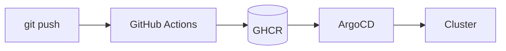

# Markdown — Cheat Sheet

Markdown for READMEs, docs and notes, with the GitHub extras (tables, task lists, alerts, Mermaid). Most of it also works in Obsidian, VS Code and GitLab.

---

## Text

```markdown
# Title 1
## Title 2
### Title 3            (up to ######)

**bold**   *italic*   ***both***   ~~strikethrough~~   `inline code`

Line one with two spaces at the end··   (·· = 2 spaces)
or a backslash at the end\
forces a line break. An empty line starts a new paragraph.

---                    Horizontal line (empty line before it)

> Quote
> > Nested quote
```

Escape a special character with `\`: `\*not italic\*`, `\# not a title`, `\|` in a table.

---

## Lists

```markdown
- Item                 (- or * or +)
- Item
  - Sub-item           (indent 2 spaces)

1. First
2. Second
   1. Sub-step         (indent 3 spaces)

- [x] Done             Task list (GitHub, Obsidian)
- [ ] To do
```

---

## Links and images

```markdown
[Text](https://example.com)
[Text](https://example.com "Tooltip")
<https://example.com>                     Raw link

[Other file](./docs/setup.md)             Relative link (works on GitHub and locally)
[Section of this file](#install-and-run)  Anchor
[Section of another file](./setup.md#network)

         Image
[](https://example.com)   Clickable image

[Text][ref]                               Reference link...
[ref]: https://example.com                ...defined anywhere in the file
```

### Anchors (GitHub)

Heading → lower case, spaces become `-`, punctuation removed.

| Heading | Anchor |
|---|---|
| `## Install and run` | `#install-and-run` |
| `## ufw (Ubuntu)` | `#ufw-ubuntu` |
| `### /etc/fstab` | `#etcfstab` |
| Second `## Notes` in the file | `#notes-1` |

### Image size

Markdown can't set a size: use HTML.

```html

```

---

## Code

````markdown
Inline: run `kubectl get pods`.

```bash
kubectl get pods -A
```

```yaml
apiVersion: v1
kind: Pod
```
````

Common languages: `bash`, `sh`, `console`, `yaml`, `json`, `hcl` (Terraform), `dockerfile`, `python`, `sql`, `ini`, `nginx`, `diff`, `text`.

To show a code block inside a code block, use 4 backticks (or `~~~`) for the outer one.

```diff
- replicas: 1
+ replicas: 3
```

---

## Tables

```markdown
| Command | Effect | Port |
|:--------|:------:|-----:|
| start   | Start  |   80 |
| stop    | Stop   |  443 |
```

- `:---` left, `:---:` center, `---:` right.
- Columns don't need to be aligned in the source.
- A `|` inside a cell: `\|`. A line break inside a cell: `<br>`.
- No merged cells, no multi-line blocks: use a list or HTML if needed.

---

## GitHub extras

### Alerts

```markdown
> [!NOTE]
> Useful information.

> [!TIP]
> Helpful advice.

> [!IMPORTANT]
> Key information.

> [!WARNING]
> Needs attention.

> [!CAUTION]
> Risk of data loss.
```

### Collapsible section

```markdown
<details>
<summary>Full output</summary>

Text or code here (keep the empty line after </summary>).

</details>
```

### Footnotes

```markdown
Talos is immutable.[^1]

[^1]: No SSH, everything goes through talosctl.
```

### Mermaid diagrams

````markdown

````

Also `sequenceDiagram`, `gantt`, `pie`, `stateDiagram`. Rendered by GitHub, GitLab and Obsidian.

### Other

```markdown
:rocket: :white_check_mark: :warning:      Emoji shortcodes
@username   #123                            Mention, issue / PR link
<kbd>Ctrl</kbd>+<kbd>C</kbd>                Keyboard keys
$E = mc^2$                                  Math (inline), $$...$$ for a block
<!-- Hidden comment -->
```

---

## README structure

```markdown
# Project name

One sentence: what it is and why.


## Features
## Requirements
## Quick start          ← Copy-paste commands that work
## Configuration
## Project structure
## Roadmap
## License
```

### Badges (shields.io)

```markdown


```

Profile README: a repo with the same name as your GitHub account (`PoissonChevre/PoissonChevre`), with a `README.md` at the root.

---

## Tools

```bash
# Preview
# VS Code: Ctrl+Shift+V (preview), Ctrl+K V (side by side)
glow README.md                          # Render in the terminal

# Lint and format
npx markdownlint-cli2 "**/*.md"         # Style rules (headings, lists, line length...)
npx prettier --write "**/*.md"          # Format tables and lists

# Convert
pandoc README.md -o README.pdf
pandoc README.md -o README.docx
pandoc notes.md -s -o notes.html
```

Check broken links in CI: `lychee` (GitHub Action `lycheeverse/lychee-action`).

---

## Pitfalls

- Put an **empty line** before and after headings, lists, code blocks and tables, or they may not render.
- Code block without a language = no colors: always add one.
- Relative links with `./` work on GitHub and in editors; absolute GitHub URLs break when you rename the repo.
- Anchors change when you rename a heading: update the links.
- Image file names are case-sensitive on GitHub (`Diagram.png` ≠ `diagram.png`).
- Tables: same number of columns on every line, `\|` for a pipe inside a cell.
- Inside HTML blocks (`<details>`, `<div>`), leave an empty line before Markdown content.
