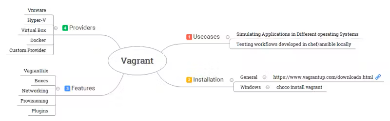
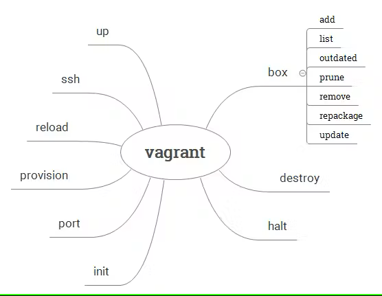

# Vagrant

> Based on [DevOps Journey — Vagrant 101 Tutorial](https://www.youtube.com/watch?v=a6W1hF9CgDQ)

Vagrant is a tool from HashiCorp. It creates and manages virtual machines (VMs). You describe the VM in one file, and Vagrant creates it. Everybody in the team gets the same environment, so the code works the same way on every computer.



Creating and configuring VMs by hand takes a lot of time. With Vagrant, you write the configuration of one or more VMs in a `Vagrantfile`. Then you run `vagrant up`, and Vagrant reads the file and creates the VMs.

## Vagrantfile

The `Vagrantfile` contains the configuration of the VM: image, CPU, RAM, network, storage, provisioning.

- It uses Ruby syntax.
- It contains everything: you only need to share this file to create the same VM on another computer.
- You can save it in Git with your project.


## Provisioning

Provisioning means configuring the VM after it starts. You can use:

- Shell scripts (in the Vagrantfile or in a separate file)
- Configuration tools: Ansible, Chef, Puppet

## Boxes

A box is a VM image for Vagrant. You can find boxes on the [HashiCorp Vagrant registry](https://portal.cloud.hashicorp.com/vagrant/discover) and download them with:

```bash
vagrant box add <box-name>
```

Each box works only with some providers. Check that the box is compatible with your provider (VirtualBox, libvirt/KVM, Hyper-V, VMware).

### ⚠️ The HCP Vagrant registry will close

HashiCorp will stop HCP Vagrant, the public registry of boxes (the old name was Vagrant Cloud). Short box names like `bento/ubuntu-24.04` are downloaded from this registry. When it closes, Vagrantfiles that use these names will not work anymore. The Vagrant command line tool will continue to work.

| Step | Date |
|---|---|
| No more new boxes | December 14, 2026 |
| End of support | March 15, 2027 |
| Registry closed, boxes deleted | June 7, 2027 |

Source: [HCP Vagrant deprecation notice](https://developer.hashicorp.com/hcp/docs/vagrant/hcp-vagrant-eol)

**Solution:** save a copy of your boxes and host them yourself (shared folder, web server, S3 bucket).

```bash
# List the boxes on your computer
vagrant box list

# Save a box in a .box file
vagrant box repackage <box-name> <provider> <version>

# Add the box again later, from a file or a URL
vagrant box add my-box ./package.box
```

In the `Vagrantfile`, use your own box:

```ruby
config.vm.box = "my-box"
config.vm.box_url = "https://my-server/boxes/package.box"
```

## Network

| Mode | Use |
|---|---|
| **Port forwarding** | Connects a port of the host to a port of the VM |
| **Private network** | Private IP address, the VM is visible only from the host and other VMs on it |
| **Public network** | The VM is on your local network, other devices can access it |

## Commands

You use Vagrant only with the [command line](https://developer.hashicorp.com/vagrant/docs/cli).



| Command | Action |
|---|---|
| `vagrant init <box>` | Create a `Vagrantfile` |
| `vagrant up` | Create and start the VM |
| `vagrant ssh` | Connect to the VM |
| `vagrant status` | Show the state of the VM |
| `vagrant provision` | Run the provisioning again |
| `vagrant reload` | Restart the VM with the new `Vagrantfile` |
| `vagrant halt` | Stop the VM |
| `vagrant destroy` | Delete the VM |

## Resources

**Official**  

- [HashiCorp tutorials](https://developer.hashicorp.com/vagrant/tutorials)
- [Vagrant on GitHub](https://github.com/hashicorp/vagrant)
- [Cheat sheet](https://gist.github.com/wpscholar/a49594e2e2b918f4d0c4)

**Tutorials (English)**  

- [devopscube — Vagrant tutorial for beginners](https://devopscube.com/vagrant-tutorial-beginners/)
- [Installation, setup and cheat sheet](https://learningdevops.hashnode.dev/chapter-3-about-vagrant-installation-and-setup-vagrant-cheat-sheet)
- [Vagrant libvirt plugin for KVM on Ubuntu](https://www.youtube.com/watch?v=PywnhhboKyQ) (video)

**Tutorials (French)**  

- [Stéphane Robert — Maîtriser Vagrant](https://blog.stephane-robert.info/docs/infra-as-code/provisionnement/vagrant/introduction/)
- [Eazytraining — Full Vagrant course for DevOps](https://www.youtube.com/watch?v=z4209uoIbmk) (video) · [labs](https://github.com/eazytrainingfr/vagrant-for-devops)
- [Xavki — Vagrant K8s series](https://www.youtube.com/watch?v=2P8jQIN5hr0) (video) · [code](https://gitlab.com/vagrant3/vagrant-k8s)

**Examples**  

- [DevOps Journey — Vagrant labs](https://github.com/devopsjourney1/vagrant-labs)
- [Vagrantfile examples](https://github.com/patrickdlee/vagrant-examples)  
